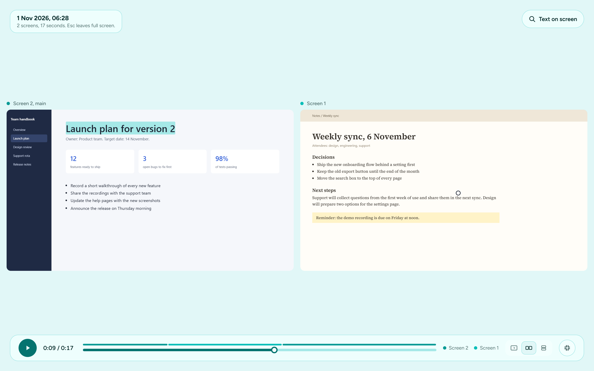

<p align="center">
  <picture>
    <source media="(prefers-color-scheme: dark)" srcset="docs/logo-dark.svg">
    
  </picture>
</p>

<h1 align="center">Screenilux</h1>

<p align="center">
  <strong>Record every screen at once. Cut it into a demo. Send it as a GIF or a private link.</strong>
</p>

<p align="center">
  <a href="https://screenilux.github.io">screenilux.github.io</a>
</p>

<p align="center">
  <a href="https://github.com/screenilux/screenilux/actions/workflows/ci.yml"></a>
  <a href="https://github.com/screenilux/screenilux/releases/latest"></a>
  
  <a href="LICENSE"></a>
  
  <a href="https://www.rust-lang.org"></a>
</p>

<p align="center">
  <a href="#download">Download</a> ·
  <a href="#recording">Recording</a> ·
  <a href="#editing">Editing</a> ·
  <a href="#sending-it">Sending it</a> ·
  <a href="#how-it-compares">How it compares</a> ·
  <a href="#building-it-yourself">Build it</a>
</p>

---

Screenilux is the screen recorder for people who work across more than one
screen, and who have to turn what they caught into something worth sending.

- **Every screen, in sync.** It records all your monitors at the same time,
  each as its own sharp video, and plays them back in step, following your
  pointer from screen to screen. Other recorders capture one screen, or
  squeeze several into one wide, blurry video.
- **Editing without a track for every kind of thing.** Click the picture to
  put an effect where you are pointing. Drag the timeline to pick a stretch
  and say what happens to it. Nothing is written into the recording.
- **Links only your recipients can watch.** Share a recording and it is
  encrypted on your computer first. The key is in the link, so neither
  Screenilux nor whoever stores it can watch, and the people you send it to
  can still play every screen in a browser.

It is free and open source for Windows and Linux, with no account and no
limits on length.

<p align="center">
  
</p>

## Why Screenilux

| | |
|---|---|
| **Every screen, in sync** | Most recorders capture one screen, or squeeze several into one wide, blurry video. Screenilux records each screen at its full size and keeps them on one clock, so playback can follow the pointer from one to the next. |
| **One window, one recording** | Recording, editing and watching are three tabs of the same window. There is one decoder, one clock and one picture, and nothing to arrange. |
| **A GIF small enough to paste** | Export a demo as a looping GIF that carries only what moved between frames. A seven-second recording comes out at about 490 KB rather than six megabytes. |
| **Private links** | Shared recordings are encrypted before they leave your computer, with the key in the link. Only the people you send it to can watch. |
| **Yours, on your computer** | No sign-up and no limits on length or number of recordings. Files are standard MP4s you can keep, move and open anywhere. |
| **Stays out of the picture** | While you record, the window shrinks to a small bar that never shows up in the video (on Windows). |

## Recording

<p align="center">
  
</p>

- **One screen or several at once.** Live previews show what each screen is
  showing; tick the ones to record.
- **Your voice and your computer's sound.** Record the microphone, what your
  computer plays (videos, calls, apps), or both mixed together.
- **Camera bubble.** Add your camera as a round bubble you can drag anywhere,
  even while recording.
- **Pointer effects.** Show the pointer, zoom in with `Ctrl+Alt` and the mouse
  wheel, and hear a soft click each time you click.
- **Pause whenever you like.** The paused time is left out of the video.
- **New screens are found by themselves.** Plug a screen in or unplug one and
  the list updates.
- **A link the moment you stop.** Turn on sharing and the link is on your
  clipboard as soon as you stop. See [Sending it](#sending-it).

## Editing

Open a recording and it lands on the **Edit** tab, which is where it is both
watched and shaped. The picture fills the window, the timeline runs along the
bottom, and the effects on it are listed beside it.

Editing a demo is two questions — *where* and *when* — so there are two places
to answer them.

- **Click the picture** to put an effect where you are pointing: zoom, zoom
  and follow the pointer, spotlight, blur, hide, or point at something. On a
  two-screen recording the effect remembers which screen it landed on.
- **Drag the timeline** to pick a stretch and choose what happens to it: cut
  it out, trim an end, speed it up, hold on a frame, caption it, mute it, or
  force one screen to be the one on show.

The chooser that opens is searchable, so an effect you half remember is faster
to type than to find.

**Nothing is written into the recording.** Effects are kept beside it in the
recording's own file and drawn on the way out, so any of them comes off again
by deleting it. Click an effect in the list to open it and change its times,
its strength or its words.

> **What is drawn today.** Cuts, trims and speed-ups change what you get when
> you export. Zoom, blur, spotlight, captions and backdrops are placed and
> saved now, and are drawn in a coming release.

- **Watch while you work.** Space plays and pauses, `F` fills the screen, and
  `Esc` brings the window back.
- **Choose how several screens sit:** one at a time following the pointer,
  side by side, or stacked.

<p align="center">
  
</p>

## Sending it

### As a GIF

**Export GIF**, next to the link, writes the demo as a looping picture with no
sound — small enough for a README, a pull request or a chat message, and it
plays by itself wherever it is pasted.

It writes only what moved between frames and leaves the rest of the picture
standing, which is where nearly all of the saving comes from: a seven-second
recording is about **490 KB** rather than **six megabytes**. Cuts and
speed-ups apply, so the GIF is the length the editor said it would be. It is
saved beside the recording.

### As a link

Turn on **Share a link when you stop** in **Settings** (the gear). When you
stop recording, Screenilux uploads the recording and copies a link to it.
Anyone you send it to can open it in a browser and watch every screen play in
step, with no account and nothing to install.

You can send the link straight away. Until the upload finishes, the page
shows how far along it is, then starts playing by itself.

**Only people with the link can watch.** Recordings are encrypted on your
computer before they are uploaded, and the key is part of the link. Neither
Screenilux nor your storage provider can watch them.

Choose where recordings go:

- **Screenilux.** Nothing to set up. Links last 7 days, and each computer
  can have up to 1 GB shared at a time.
- **My bucket.** Your own storage: Cloudflare R2, Amazon S3, Backblaze B2,
  Wasabi or any other S3-compatible service. Recordings stay until you delete
  them, and your keys never leave your computer.
  [Setting up your own storage](docs/own-storage.md) takes about five minutes.

Recordings still open only in the Screenilux app on your computer; the
browser page is for the people you send the link to. In Settings you can
also choose not to keep a copy on your computer once a recording is
uploaded.

## How it compares

Tools like Loom are built for sending a quick talking-head video to a
colleague. Screenilux is built for the work itself: everything across your
screens, shaped into a demo afterwards, and private when shared.

| | Screenilux | Loom |
|---|---|---|
| Several screens at once | Yes, played back together in step | One screen per recording |
| Editing | Click the picture or drag the timeline; effects stay separate from the recording | Trim, and stitch clips together |
| Export as a GIF | Yes, and only what moved is written | No |
| Shared links | Encrypted on your computer; only people with the link can watch | Kept on Loom's servers, protected by link settings and passwords |
| Where recordings are kept | On your computer, and in your own storage if you like | On Loom's servers |
| Length and number | No limits | 5 minutes and 25 recordings on the free plan |
| Account | None | Required |
| Price | Free and open source | Free plan with limits, or a monthly fee per person |

Screenilux does not try to be a video messaging service. Comments,
reactions, view analytics and AI summaries are what Loom and similar tools
do well, and are not on its list. What is on it: more of the three things
above, on more computers.

<sub>Loom's details are from its help pages and plan listings in November 2026.</sub>

## Download

Get the latest version from
[Releases](https://github.com/screenilux/screenilux/releases/latest).

**Windows 10 and 11**

1. Download the Windows zip and unzip it.
2. Run `screenilux.exe`. There is nothing to install and no administrator
   rights are needed.

The app is not signed yet, so Windows may say it protected your PC the first
time. Choose **More info**, then **Run anyway**.

**Linux**

1. Install GStreamer for video and sound. On Ubuntu or Debian:

   ```
   sudo apt install gstreamer1.0-plugins-good gstreamer1.0-plugins-bad gstreamer1.0-plugins-ugly gstreamer1.0-libav
   ```

2. Download the Linux file, unpack it and run `screenilux`.

Screenilux on Linux records an X11 session. On Ubuntu, choose
**Ubuntu on Xorg** on the login screen. Wayland sessions are not supported yet.

Recordings are saved in `Videos/ScreenRec` in your home folder. A single
screen is saved as an MP4 that plays anywhere. Several screens are saved
together as one `.screenilux` file, which opens in Screenilux.

## Good to know

- Zooming in while recording makes the picture slightly softer.
- Zoom cannot follow the pointer yet, and clicks cannot be marked: both need
  the recorder to keep a note of where the pointer was, which it does not do
  today.
- Exporting a GIF overwrites one of the same name beside the recording.
- Long multi-screen recordings take a moment to open.
- Pointer effects do not work over apps running as administrator.
- On Linux, the recording bar and the camera preview show in the recording,
  because X11 has no way to hide a window from capture. Turn off **Shrink to a
  bar while recording** to keep the bar out of the way.

## Building it yourself

Install [Rust](https://rustup.rs). On Linux, also install GStreamer's
development files (`libgstreamer1.0-dev libgstreamer-plugins-base1.0-dev` on
Ubuntu). Then run:

```
cargo run --release -p screenilux
```

Ideas and fixes are welcome: open an
[issue](https://github.com/screenilux/screenilux/issues) or a pull request.
See [Contributing](CONTRIBUTING.md) for how, including the one-comment
[Contributor Licence Agreement](CLA.md).

## Licence

[GPL-3.0](LICENSE). You are free to use, change and sell Screenilux. If you
share a changed version, you must share its source code under the same
licence.
