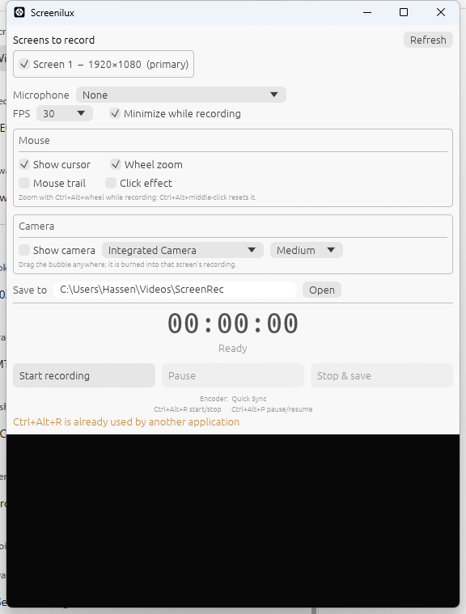

# Screenilux

A screen recorder and player for Windows. Record one screen or several at
once, with a draggable camera bubble, pointer zoom and click effects, then play
them back in step and copy or search the text on screen.



## Features

- **Record several screens at once.** Each gets its own file, captured in
  parallel and numbered from a shared clock, so frame *N* of one screen is the
  same instant as frame *N* of the others. Measured at 0–2 frames of skew.
- **Start / pause / resume / stop.** Paused time is excluded; the video cuts
  straight from pause to resume.
- **Mouse effects:** a cursor marker (Windows capture omits the pointer),
  `Ctrl+Alt+wheel` zoom up to 5× with `Ctrl+Alt+middle-click` to reset, a
  fading trail, and expanding rings on click.
- **Camera bubble**, draggable anywhere — including mid-recording — and burned
  into that screen's recording. The preview window is hidden from capture, so
  the recording gets exactly one copy.
- **Hardware encoding with no external dependencies.** H.264 comes from
  Windows' own Media Foundation encoder, so there is nothing to install and
  nothing to bundle — the whole application is one executable.
- **Global hotkeys**: `Ctrl+Alt+R` start/stop, `Ctrl+Alt+P` pause/resume.
  If another application already owns one, the window says so.
- **A player for multi-screen recordings.** The Play tab plays every screen in
  step, either *auto switch* (one screen at a time, following where the
  pointer was) or *side by side* / *stacked*. Open a recording with the Open
  button, by dropping it on the window, or with *Play it* after saving.
- **Copyable text.** Pause and the text on screen becomes selectable: drag
  across it and `Ctrl+C`, or *Copy all text*. It is read by the OCR engine
  built into Windows, so it works offline and costs nothing.
- **Searchable recordings.** *Make text searchable* reads every screen every
  two seconds and saves the result with the recording; search then lists each
  place a phrase appeared, and clicking one jumps there.

## Building

Needs a Rust toolchain (1.95+). Nothing else — no ffmpeg, no C or C++
toolchain, no runtime to install.

```
cargo run --release -p screenilux
```

`ffprobe` is used by the opt-in end-to-end tests to verify output files. That
is a development tool; the application never shells out to anything.

## Output

One screen gives a single H.264 MP4, which plays anywhere. Several give one
`.screenilux` file:

```
recording_2026-10-31_12-12-49.screenilux
  recording.json     the manifest, first so it can be read without seeking
  screen1.mp4
  screen2.mp4
  text.json          the search index, once the text has been read
```

A `.screenilux` file is a ZIP archive, so renaming it to `.zip` shows the files
inside. Entries are stored rather than compressed, since H.264 does not shrink
further, and ZIP64 is always on, so recordings over 4 GB are fine. The player
also opens an unpacked session folder (pick its `recording.json`) and any MP4.

`recording.json` is the `screenrec-session` format. It records each screen's
size, its virtual-desktop position (so a player can rebuild the real monitor
arrangement, vertical offsets included), which file carries the microphone,
and a display `order` with the primary first.

Multi-screen sessions also carry a **focus timeline** for auto-switch playback:

```json
"focus": {
  "source": "pointer", "dwell": 0.6,
  "timeline": [
    { "t": 0.0,   "screen": "screen1.mp4" },
    { "t": 1.539, "screen": "screen2.mp4" }
  ]
}
```

Each entry means *from time `t` (recorded seconds), show this screen*. Switches
are debounced: a pointer crossing one monitor to reach another is not a visit,
and a switch is stamped at the moment the pointer *arrived*, not when the dwell
expired, so playback cuts at the real moment.

## How it works

```
crates/core      pure logic - geometry, pacing, focus, compositor, manifest,
                 package format, layouts, playback clock, text index
crates/win       Windows adapters - capture, encoder, decoder, audio in and
                 out, OCR, hook, camera
crates/recorder  recording - per-screen threads, shared clock, manifest
crates/player    playback - per-screen decode threads on one clock, sound,
                 reading and indexing text
crates/app       the egui window, the camera overlay and the Play tab
```

`core` depends on neither Windows nor any UI toolkit, so everything worth
testing is testable without a screen, a camera or an encoder. All `unsafe` is
confined to `crates/win`; the others are `#![forbid(unsafe_code)]`.

**Encoding is native.** Frames go to Media Foundation through
`VideoSink::write`, and because the recorder owns the timestamps, **a pause is
simply an absence of frames** — the numbering stays contiguous, so paused time
does not exist in the output. There are no segments and no join pass, which
removes a whole class of failure around stitching separately-encoded files.
Microphone audio is captured directly from WASAPI.

A few decisions that are load-bearing and look removable:

- **Pacing is pegged to the wall clock**, not a frame counter. When capture
  falls behind, the last frame is written again so playback stays real-time
  rather than running fast. A segment is also topped up before it closes, or a
  stall right before a pause would silently shorten the clip.
- **Frames are written bottom-to-top.** Media Foundation's raw-buffer path
  wants BGRA in reverse row order; feeding it top-to-bottom produces a
  vertically mirrored video, which is easy to miss until someone plays it back.
- **Overlays are composited after the zoom**, so the cursor, trail and rings
  keep a constant pixel size. The camera deliberately does not move or scale
  with zoom — it is a picture-in-picture pinned to the frame.

Capture uses Windows Graphics Capture, which only delivers a frame when the
screen actually changes — an idle screen costs almost nothing, and unlike the
old GDI path it sees fullscreen games and hardware-overlay video.

**Decoding is native too.** The player reads video from Media Foundation as
NV12 and converts it itself, because Media Foundation's own RGB output decodes
1080p at about 100 fps against about 540 for NV12. Two 60 fps screens need
120. Seeking lands on the requested frame, not the keyframe before it.

**Playback mirrors recording.** Each screen has its own decode thread, and all
of them follow one clock rather than signalling each other, the way the
recorder's capture threads all number frames from one start instant. Sound has
its own thread, and every pause or seek restarts it from the clock's position.

**Text is read with Windows' OCR engine**, chosen because it gives each word's
position (which is what makes drag-to-select on the video possible), works
offline, and is already installed. It reads a 1080p screen in about 80 ms. The
indexer decodes each screen once from start to end, converts only the frames
it samples, and skips OCR when a sample looks the same as the previous one, so
a screen that does not change costs little more than decoding it.

## Testing

```
cargo test --workspace
cargo test -p screenilux-recorder -- --ignored --test-threads=1
```

The second set records real hardware for several seconds each, so it is opt-in.
It covers a single-screen recording, a pause excluding both picture and
microphone, every screen recorded in sync into a valid package, and two
recordings in the same second not overwriting each other.

Two examples cover the same paths without driving the window:

```
cargo run --release -p screenilux-recorder --example record -- 6 out --twice
cargo run --release -p screenilux-player --example read_text -- out/<file> "search words"
```

`--twice` records the primary display as two screens, which exercises
multi-screen saving and playback on a machine with one monitor.

## Known limitations

- **Microphone only, no system audio.** Capturing what your speakers play means
  a WASAPI loopback client, which is separate work from the microphone path.
- **Hotkeys and the pointer hook do not see events over an elevated window**
  unless Screenilux is elevated too.
- **Zoom is a crop scaled back up**, so zooming in softens the image; it does
  not re-capture at higher detail.
- Stopping takes up to ~120 ms, bounded by the capture frame timeout.
- **Opening a `.screenilux` file unpacks it to a temporary folder first**, so a
  long recording takes a moment to open. The entries are stored uncompressed,
  so playing directly from inside the archive is possible later.
- **OCR needs a Windows language with text recognition installed.** If none
  is, the player says so and explains where to add it.
- **Text that is on screen for under two seconds may be missing from search.**
  Pausing on it and selecting still works, because that reads the exact frame.

## Licence

GPL-3.0. That permits anyone to copy, modify and sell this software; what it
forbids is distributing a modified version without source under a more
restrictive licence. It blocks closed-source forks, not commercial use.

Nothing GPL is linked or bundled — the choice is the project's own, not an
obligation inherited from a dependency.

`legacy/` holds the original Python build, kept for comparison.
