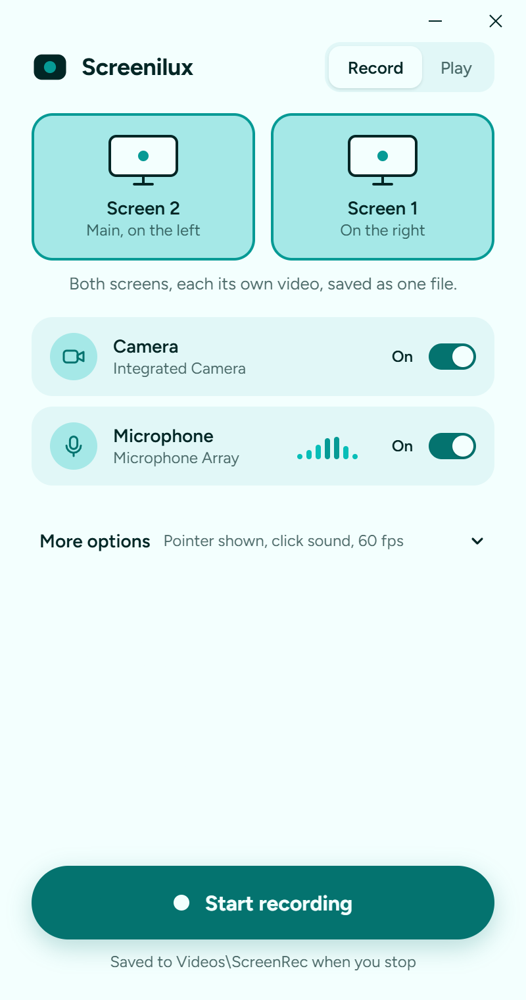
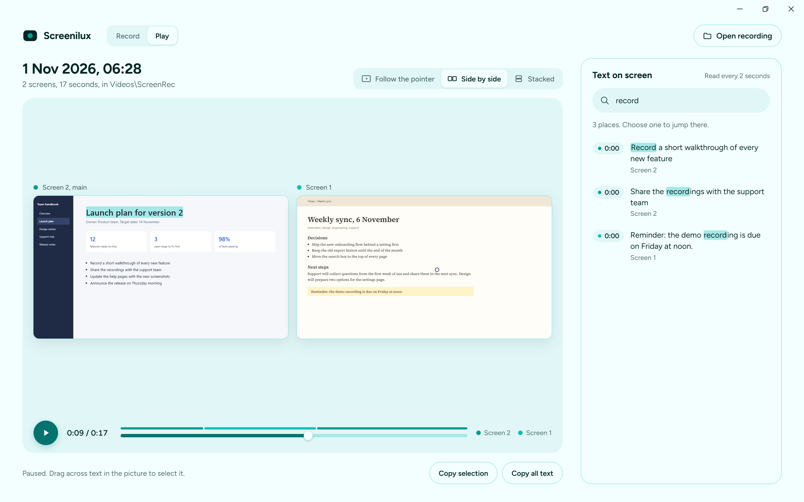

# Screenilux

Record your screens on Windows, then play them back and copy any text you see
in them.



## Recording

- **One screen or several at once.** Each screen gets its own video, and they
  all stay in step.
- **Pause whenever you like.** The paused time is left out of the video.
- **Out of your way.** While you record, the window shrinks to a small bar at
  the bottom of the screen. The bar never appears in the recording.
- **Pointer effects.** Show the pointer, zoom in with `Ctrl+Alt` and the mouse
  wheel, and hear a soft click each time you click.
- **Your voice and your PC's sound.** Record the microphone, what your PC
  plays (videos, calls, apps), or both mixed together.
- **Camera bubble.** Add your camera as a round bubble you can drag anywhere,
  even while recording.
- **New screens are found by themselves.** Plug a screen in or unplug one and
  the list updates.

## Playing



- **Every screen plays together:** one at a time following the pointer, side
  by side, or stacked.
- **Copy text straight from the video.** Pause, then drag across any words to
  select and copy them.
- **Search inside recordings.** Choose *Make text searchable*, then search for
  a word and jump to each place it appeared.
- **Open recordings your way:** double-click one, drop it on the window, or
  use *Open*.

## How it differs from Loom

Loom is built for sending a quick video as a link. Screenilux is built for
recording everything you are working on, on your own computer.

|                                | Screenilux                            | Loom                                        |
| ------------------------------ | ------------------------------------- | ------------------------------------------- |
| Several screens at once        | Yes, played back together in step     | No, one screen per recording                |
| Length of a recording          | No limit                              | 5 minutes on the free plan                  |
| Number of recordings           | No limit                              | 25 per person on the free plan              |
| Account                        | None                                  | Required                                    |
| Where recordings are kept      | On your PC                            | On Loom's servers                           |
| Price                          | Free and open source                  | Free plan with limits, or a monthly fee per person |

Screenilux also reads the text on screen, on your PC and without internet, so
you can copy it from a paused video or search a recording for a word.

Loom is ahead in sharing: an instant link, comments and reactions, and apps
for Mac and phones. Screenilux runs on Windows only for now, and a share link
is next (see below).

Loom's limits are from its help pages and plan listings in November 2026.

## Getting it

1. Download the latest zip from
   [Releases](https://github.com/EagleMind/screenilux/releases/latest).
2. Unzip it and run `screenilux.exe`. There is nothing to install and no
   administrator rights are needed.

The app is not signed yet, so Windows may say it protected your PC the first
time. Choose **More info**, then **Run anyway**.

Recordings are saved in `Videos\ScreenRec`. A single screen is saved as an MP4
that plays anywhere. Several screens are saved together as one `.screenilux`
file, which opens in Screenilux.

## Good to know

- Zooming in makes the picture slightly softer.
- Copying text needs a Windows language with text recognition installed. The
  app tells you if it is missing and where to add it.
- Text shown for less than two seconds may not turn up in search, but you can
  still pause on it and copy it.
- Long multi-screen recordings take a moment to open.
- Pointer effects do not work over apps running as administrator.

## Upcoming

- **Share a link in seconds.** Stop recording and get a link that anyone can
  open in their browser to watch, the way Loom does. Keeping recordings only on
  your PC will stay an option.

## Building it yourself

Install [Rust](https://rustup.rs), then run:

```
cargo run --release -p screenilux
```

## Licence

GPL-3.0. You are free to use, change and sell Screenilux. If you share a
changed version, you must share its source code under the same licence.
